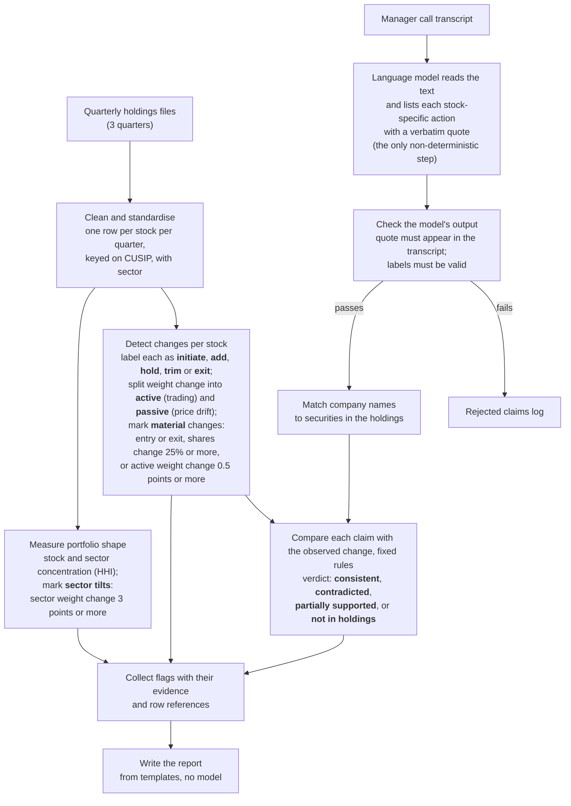

# Stonebridge Case Study -- Anbang Du
At high level, my first principle for designing such system is to maximise determinism and minimise non-determinism so that the LLM is only used when it is really needed. In below proposed system, code does every calculation, comparison and verdict, and an LLM extracts claims from scripts with schema-enforced output containing traceable references. In the end the analyst will get traceable report of inconsistencies (between call scripts and holding) and flagged holding changes at stock and sector level. The workflow is illustrated in the flowchart below and explained in detail in the next section. The system code and outputs are in this [Github Repo](https://github.com/adamdu001/portfolio-agent). Please feel free to inspect and run it.

# Data Model and Analytical Logics
To give an overview of the data model: three base tables are linked on the CUSIP, with derived tables built on top. **Holdings** has one row per CUSIP, quarter and position, with shares, price, weight and the source row in the Excel file. The CUSIP is the key, zero-padded to nine characters, because the files lose leading zeros and tickers change. **Security reference** holds the CUSIP, ticker, name, a hand-assigned GICS sector and an aliases column of spoken name variants. **Claims** has one row per stock-specific action the manager states, with the verbatim quote, source_id, character offsets, paragraph numbers, action, quarter, multi_quarter and a short rationale. From holdings I derive **signals** (one row per CUSIP and pair of consecutive quarters, with the action, shares and weight before and after, active_w, passive_w, the streak, is_material and the source rows in both files), **portfolio summary** (one row per quarter, with concentration, top-10 weight and names in and out) and **sector weights** (one row per quarter and sector, with the change in points and is_tilt). **Signals** are the ground truth that **claims** are checked against: **claims** join to them through the CUSIP that the alias list resolves, and the result is saved as **claim checks**, with the verdict, reason and evidence rows.

In the following paragraphs I illustrate the step by step workflow, the analytical logics, and the rationale behind the design. Note that all the derived data files are stored in the "`portfolio-agent/data/processed`" folder; all the execution files are in the "`portfolio-agent/portfolio_agent`" folder. 

First, I propose to read the three Excel files into one table with a row per stock per quarter, keyed on CUSIP, and attach a sector and aliases from the reference table. This aims to create one consistent holdings table, avoids the problems such as occasional loss of leading zeros in CUSIP in Excel files and potential ticker changes. Scripts that execute these and the output files are shown as below.
| # | Step | Script (`portfolio_agent/`) | Output (`data/processed/`) |
|---|---|---|---|
| 1 | Clean and standardise holdings | `load.py`, `reference.py`, `aliases.py` | `holdings.csv`, `security_reference.csv`, `reconciliation.csv` |

Then the problem is to detect significant changes in holdings. I propse to create a table to capture such signal, consisting of the following parts. (i) For each stock and pair of consecutive quarters, I label the action into any of the four: initiate, add, hold, trim, exit, based on comparison of the number of shares. (ii) I further split the weight change into active trading (`active_w`) and passive price drift (`passive_w`). This is achieved by first computing the weight assuming the manager had not traded at all (`w_unchanged`). Specifically `w_unchanged` for each stock is the product of its last quarter's share count and its value at this quarter's price, divided by the sum of such product over all stocks plus cash. The weight change due to passive price drift would then be `passive_w = w_unchanged - w_prev`. Any remaining move to this quarter's actual weight is active, because only the share count can explain it: `active_w = w_curr - w_unchanged`. Initiates and exits have no such split. (iii) I also count the streak of actions, i.e., for how many quarters a certain action has lasted, in order to prepare for checking the period-based claims from call scripts. (iv) I flag any "material change" (`is_material==True`) if it is an entry or exit, moves shares by 25% or more, or moves active weight by 0.5 points. The numeric value a tunable threshold. (v) I also added the row index of the resepctive source files of each stock for traceability. Scripts and output files as below.

| # | Step | Script (`portfolio_agent/`) | Output (`data/processed/`) |
|---|---|---|---|
| 2 | Detect changes per stock | `signals.py` | `signals.csv` |

Then, I compute concentration using HHI at both stock (`hhi`) and sector (`sector_hhi`) level. As shown `portfolio_summary.csv`, stock level HHI does not reveal much change through the three quarters. Yet sector level HHI reveals concentrations. In `sector_weights.csv` I record the share of each sector in the portfolio and flag sectors that moved 3 points or more. The threshold is again tunable. Scripts and output files as below.

| # | Step | Script (`portfolio_agent/`) | Output (`data/processed/`) |
|---|---|---|---|
| 3 | Measure portfolio shape | `portfolio.py` | `portfolio_summary.csv`, `sector_weights.csv` |

Next I deal with claim extraction from the transcript. Due to its unstructured nature, I make use of LLM API calls (GPT4o) with prompt instructions and schema-restricted output format (see `extract.py` for the exact prompt and `llm.py` for the API call). Specifically, I ask the LLM to list every stock-specific action the manager states, with company name, a verbatim quote, the quarter or the period, and a short optional rationale (to summarise manager's reasoning). As a model can reword or invent text, and I need every claim traceable, so I write code that rejects any claim whose quote is not in the transcript or whose labels are invalid, and records where each accepted quote sits (offsets and paragraphs). In addition, as mentioned above, to resolve the name the manager used to a CUSIP, an alias list is used such that each claim gets linked to a stocked, or marked as matching nothing. Finally, I use code to compare each claim (action and timestamp) with the observed data (in the signal table) and give one of four verdicts: consistent, contradicted, partially supported, or not in holdings. Each verdict has its own template. For example, the Qualcomm reason, "Manager says add; holdings show trim (2025Q4 to 2026Q1).", comes from a template like "Manager says {claimed action}; holdings show {observed action} ({from_q} to {to_q})." The final claim check table (`claim_checks.csv`) documents every claim's asociated quote, company, action, timestamp, rationale, offset location, paragraph location, as well as the verdict cites its evidence rows from `signals.csv`.

| # | Step | Script (`portfolio_agent/`) | Output (`data/processed/`) |
|---|---|---|---|
| 4 | Read the transcript (model) | `extract.py`, `llm.py` | none (claims passed to the next step) |
| 5 | Check the model's output | `claims.py` | `claims_rejected.csv` (the rejects) |
| 6 | Match company names | `matching.py` | none (adds the CUSIP to each claim) |
| 7 | Compare claims with changes | `verdicts.py` | `claim_checks.csv` |

It is important that the analyst can read the final results with evidence. To this end, I gather the non-consistent claims, the material stock changes and the sector tilts into one JSON file (`flags.json`), then render a Markdown report from templates (`report.md`). Finally, I code an orchestration script (`run.py`) that can run step 1 to 8 in order so the report can be reproduced from the raw files in one go.

| # | Step | Script (`portfolio_agent/`) | Output (`data/processed/`) |
|---|---|---|---|
| 8 | Collect flags and write the report | `flags.py`, `render.py`, `report.py` | `flags.json`, `report.md` |
| 9 | Run everything end to end | `run.py` | all of the above |

<!-- For each stock and quarter pair, `signals.py` classifies the action (initiate, add, hold, trim, exit) and splits the weight change. Weight at old shares and new prices is the unchanged weight. The gap to the new weight is active, and the gap from the old weight is passive. Initiates and exits have no such split. A change is material if it is an entry or exit, moves shares by 25% or more, or moves weight by 0.5 points or more through trading. A streak counts consecutive quarters in one direction. `portfolio.py` adds stock and sector concentration (HHI) and flags sectors that moved 3 points or more.

Claims go through `verdicts.py`: consistent, contradicted, partially supported (direction right, streak shorter than the "few quarters" claimed, which I read as two) or not in holdings. A stock the manager names that is never held counts as a discrepancy. The model never judges whether a claim is true. -->

# Worked example

**Worked example: "we added Qualcomm in January"**

*Input.* The raw inputs are the three Excel holdings files and the call excerpt. In the December file, Qualcomm (CUSIP `747525103`) is on row 32 with 16,495 shares at $171.05, a weight of 2.78%. In the March file it is on row 31 with 12,995 shares at $128.78, a weight of 1.70%. In the June file it is on row 32 with 13,975 shares at $184.79, a weight of 2.93%. The call says: "On the new side, we added Qualcomm in January."

*Step 1, clean and standardise (`load.py`, `reference.py`).* The three files become `holdings.csv`, with one row per stock per quarter, each carrying its `source_file` and `source_row`. `security_reference.csv` links the CUSIP to ticker `QCOM`, sector Information Technology and the aliases `qualcomm|qcom`.

*Step 2, detect changes (`signals.py`, output `signals.csv`).* For December to March, shares fell from 16,495 to 12,995 (-21.2%), so the action is `trim`. The weight fell by 1.08 points. If the manager had not traded, the lower price alone would have taken the weight to 2.13%, so `passive_w` is -0.65 and `active_w` is -0.43. The active move is under the 0.5-point threshold, so `is_material` is false. For March to June, shares rose by 980 (+7.5%), so the action is `add`, with `active_w` +0.62, which is material.

*Steps 4 to 6, claims (`extract.py`, `claims.py`, `matching.py`).* The model extracts the claim: action `add`, quarter 2026Q1, with the verbatim quote. Code confirms the quote is in the transcript and records where it sits (paragraph 3, characters 416-462). The alias list resolves "Qualcomm" to `747525103`.

*Step 7, verdict (`verdicts.py`, output `claim_checks.csv`).* The claim says add in 2026Q1. The December to March signal row says trim. The verdict is `contradicted`, and the reason is written from a template: "Manager says add; holdings show trim (2025Q4 to 2026Q1)." The evidence columns carry the shares, the active weight and source rows 32 and 31.

*Output.* In `report.md`, under claims that do not match the holdings, the analyst sees the quote, its location, the verdict, the reason and the evidence. The agent does not say why they differ. One caveat belongs next to it: quarter-end snapshots cannot show activity inside the quarter, so buying in January followed by heavier selling would look the same. The June file shows a real add, which the analyst may want to ask about.

The report (`report.md`, written by `python -m portfolio_agent.run` with a matching `flags.json`) has three parts, matching the case objectives: claims that do not match the holdings, material stock changes, and sector flags (Health Care +6.98 points in Q1; sector HHI 1318, 1349, 1416). In the same report, Boeing (initiate) and Warner Bros. Discovery (exit) are consistent, and Kraft Heinz is in no file at all.

# Build priority

First the deterministic holdings layer and its tests, since everything depends on correct keys and the active/passive split. Then claim extraction with validation. Then the report. The model comes last because its output is only useful once the checks around it exist.

# Extending to richer sources

Only extraction changes. Recordings are transcribed, emails and notes read as text, each with a source id and date, and chunked. The same prompt runs per chunk and code adds source and location. Code merges claims on CUSIP and quarter and flags sources that disagree before checking holdings. Verdict rules stay the same.

# Key question: where the agent can fail

By stage, with the design response:

- **Holdings data.** Quarter-end snapshots hide timing inside the quarter (Qualcomm). Three files cap streaks at two quarter steps. Sectors are hand-assigned, so tilts depend on that choice. Response: state these as assumptions and show the step each flag covers.
- **Active versus passive.** The split assumes no trading inside the quarter. Exits are valued at their old price in the baseline. Thresholds (25%, 0.5 points, 3 points) are my defaults, and I am not yet confident in the split. Response: keep active and passive in separate columns and tune thresholds.
- **Extraction.** The model can miss an action, and nothing flags a miss. Rewordings are caught by the verbatim check, but vague phrases such as "a few quarters" need a fixed rule. Quotes can repeat, so all locations are stored. Output varies between runs. Response: repeat runs, a `claims_rejected.csv` log and a human reading the transcript for gaps.
- **Name matching.** The alias list is hand-kept, so "not in holdings" can mean a real discrepancy or a missing alias. Response: surface the name checked.
- **Verdicts and overstatement.** Contradicted means mismatch, not intent. Consistent means direction only, since size is not checked. Silence about 53 material changes is not evidence either way. Response: no model-written explanations, questions or recommendations; neutral templates.
- **Plausible but wrong explanations.** My main worry, because a fluent summary hides the weak spots above. Response: the report text comes from templates filled with numbers from cited items, so no sentence exists without a source. If a model writes wording later, code should check that every cited id exists and every quoted number appears in that item.
- **Traceability.** Claims and stocks trace to quote and row. Sector flags do not yet list member stocks. Response: join them from signals and reference.
