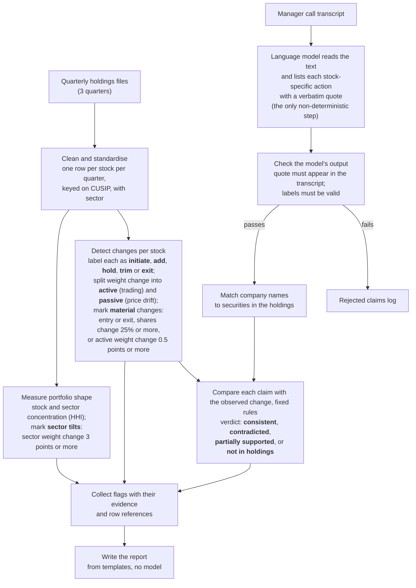

# Stonebridge Case Study -- Anbang Du
At high level, my first principle for designing such system is to maximise determinism and minimise non-determinism so that the LLM is only used when it is really needed. Specifically my design is: code does every calculation, comparison and verdict, and an LLM extracts claims from scripts with schema-enforced output containing traceable references. In the end the analyst will get traceable report of inconsistencies (between call scripts and holding) and flagged holding changes at stock and sector level. 

The workflow is shown in the flowchart below and summarised in the table further down. I will explain each step in the next section. The system code and outputs are in this [Github Repo](https://github.com/adamdu001/portfolio-agent). Please feel free to inspect and run it.

# Workflow Deign

For each stock and quarter pair, `signals.py` classifies the action (initiate, add, hold, trim, exit) and splits the weight change. Weight at old shares and new prices is the unchanged weight. The gap to the new weight is active, and the gap from the old weight is passive. Initiates and exits have no such split. A change is material if it is an entry or exit, moves shares by 25% or more, or moves weight by 0.5 points or more through trading. A streak counts consecutive quarters in one direction. `portfolio.py` adds stock and sector concentration (HHI) and flags sectors that moved 3 points or more.

Claims go through `verdicts.py`: consistent, contradicted, partially supported (direction right, streak shorter than the "few quarters" claimed, which I read as two) or not in holdings. A stock the manager names that is never held counts as a discrepancy. The model never judges whether a claim is true.

| # | Step | Script (`portfolio_agent/`) | Output (`data/processed/`) |
|---|---|---|---|
| 1 | Clean and standardise holdings | `load.py`, `reference.py`, `aliases.py` | `holdings.csv`, `security_reference.csv`, `reconciliation.csv` |
| 2 | Detect changes per stock | `signals.py` | `signals.csv` |
| 3 | Measure portfolio shape | `portfolio.py` | `portfolio_summary.csv`, `sector_weights.csv` |
| 4 | Read the transcript (model) | `extract.py`, `llm.py` | none (claims passed to the next step) |
| 5 | Check the model's output | `claims.py` | `claims_rejected.csv` (the rejects) |
| 6 | Match company names | `matching.py` | none (adds the CUSIP to each claim) |
| 7 | Compare claims with changes | `verdicts.py` | `claim_checks.csv` |
| 8 | Collect flags and write the report | `flags.py`, `render.py`, `report.py` | `flags.json`, `report.md` |
| 9 | Run everything end to end | `run.py` | all of the above |

**Workflow, step by step**

1. **Clean and standardise holdings.** *What:* read the three Excel files into one table with a row per stock per quarter, keyed on CUSIP, and attach a sector and spoken-name variants from a reference table. *Why:* the files lose leading zeros and tickers change, so every later join depends on a stable key. *Outcome:* one consistent holdings table, plus a check that our numbers agree with the files' own change columns.
2. **Detect changes per stock.** *What:* for each stock and pair of consecutive quarters, label the action (initiate, add, hold, trim, exit), split the weight change into active trading and passive price drift, count the streak, and mark material changes. *Why:* the analyst needs to know what the manager actually did, separately from what the market did to the weights. *Outcome:* a signals table where every row carries its action, its active and passive weight, and the source rows in the files.
3. **Measure portfolio shape.** *What:* compute stock and sector concentration (HHI), the sectors entering or leaving, and each sector's weight change, marking tilts of 3 points or more. *Why:* concentrations and sector shifts can build up from many small decisions that no single stock flag shows. *Outcome:* a quarterly summary and a sector weights table with tilts flagged.
4. **Read the transcript (model).** *What:* the language model lists every stock-specific action the manager states, with a verbatim quote, the action, the quarter and whether the manager says it has gone on for several quarters. *Why:* reading free text is the one job that rules cannot do well. *Outcome:* candidate claims in a fixed format. The model does not decide whether anything is true.
5. **Check the model's output.** *What:* code rejects any claim whose quote is not in the transcript or whose labels are invalid, and records where each accepted quote sits (offsets and paragraphs). *Why:* a model can reword or invent text, and we need every claim traceable. *Outcome:* a validated claims table and a log of rejected claims.
6. **Match company names.** *What:* resolve the name the manager used to a CUSIP through the alias list. *Why:* people say "Qualcomm", the files say QCOM or a legal name. *Outcome:* each claim linked to a security, or marked as matching nothing.
7. **Compare claims with changes.** *What:* fixed rules compare each claim's action and quarter with the observed change and give one of four verdicts, with a written reason. *Why:* consistency has to come from the data, not from a model's opinion. *Outcome:* a claim check table where every verdict cites its evidence rows.
8. **Collect flags and write the report.** *What:* gather the non-consistent claims, the material stock changes and the sector tilts into one JSON file, then render a Markdown report from templates. *Why:* the analyst should see evidence and sources, with no invented explanation. *Outcome:* `flags.json` and `report.md` with three sections: claim inconsistencies, stock-level flags and sector-level flags.
9. **Run everything end to end.** *What:* one command runs steps 1 to 8 in order. *Why:* so the report can be reproduced from the raw files in one go. *Outcome:* all outputs regenerated, with a short summary of counts.

Three linked tables. **Holdings**: one row per CUSIP, quarter and position, with shares, price, weight and the source row in the Excel file. CUSIP is the key, zero-padded to nine characters, because the files lose leading zeros and tickers change. **Security reference**: CUSIP, ticker, name, a hand-assigned GICS sector and an `aliases` column of spoken name variants. **Claims**: one row per stock-specific action the manager states, with the verbatim quote, `source_id`, character offsets, paragraph numbers, action, quarter, `multi_quarter` and a short rationale. Each claim is a single action in a single period. Reasoning stays as context. Claims join to holdings through the CUSIP that the alias list resolves.

## 5. Worked example

The report (`report.md`, written by `python -m portfolio_agent.run` with a matching `flags.json`) has three parts, matching the case objectives: claims that do not match the holdings, material stock changes, and sector flags (Health Care +6.98 points in Q1; sector HHI 1318, 1349, 1416).

Take Qualcomm. The signal comes from `signals.py` and the verdict from `verdicts.py`. The manager says "we added Qualcomm in January" (paragraph 3, characters 433–462). Holdings show 16,495 shares at December, 12,995 at March: a 21% trim, weight 2.78% to 1.70% (rows 32 and 31). Verdict: contradicted. The analyst sees the quote, the numbers, the rule-written reason and the rows. The agent does not say why. One honest caveat: March and December snapshots cannot show January buying followed by heavier selling. June shows 13,975 shares, a genuine add. The analyst can ask about timing. In the same report, Boeing (initiate) and Warner Bros. Discovery (exit) are consistent, and Kraft Heinz is in no file at all.

## 6. Build priority

First the deterministic holdings layer and its tests, since everything depends on correct keys and the active/passive split. Then claim extraction with validation. Then the report. The model comes last because its output is only useful once the checks around it exist.

## Extending to richer sources

Only extraction changes. Recordings are transcribed, emails and notes read as text, each with a source id and date, and chunked. The same prompt runs per chunk and code adds source and location. Code merges claims on CUSIP and quarter and flags sources that disagree before checking holdings. Verdict rules stay the same.

## Key question: where the agent can fail

By stage, with the design response:

- **Holdings data.** Quarter-end snapshots hide timing inside the quarter (Qualcomm). Three files cap streaks at two quarter steps. Sectors are hand-assigned, so tilts depend on that choice. Response: state these as assumptions and show the step each flag covers.
- **Active versus passive.** The split assumes no trading inside the quarter. Exits are valued at their old price in the baseline. Thresholds (25%, 0.5 points, 3 points) are my defaults, and I am not yet confident in the split. Response: keep active and passive in separate columns and tune thresholds.
- **Extraction.** The model can miss an action, and nothing flags a miss. Rewordings are caught by the verbatim check, but vague phrases such as "a few quarters" need a fixed rule. Quotes can repeat, so all locations are stored. Output varies between runs. Response: repeat runs, a `claims_rejected.csv` log and a human reading the transcript for gaps.
- **Name matching.** The alias list is hand-kept, so "not in holdings" can mean a real discrepancy or a missing alias. Response: surface the name checked.
- **Verdicts and overstatement.** Contradicted means mismatch, not intent. Consistent means direction only, since size is not checked. Silence about 53 material changes is not evidence either way. Response: no model-written explanations, questions or recommendations; neutral templates.
- **Plausible but wrong explanations.** My main worry, because a fluent summary hides the weak spots above. Response: the report text comes from templates filled with numbers from cited items, so no sentence exists without a source. If a model writes wording later, code should check that every cited id exists and every quoted number appears in that item.
- **Traceability.** Claims and stocks trace to quote and row. Sector flags do not yet list member stocks. Response: join them from signals and reference.
